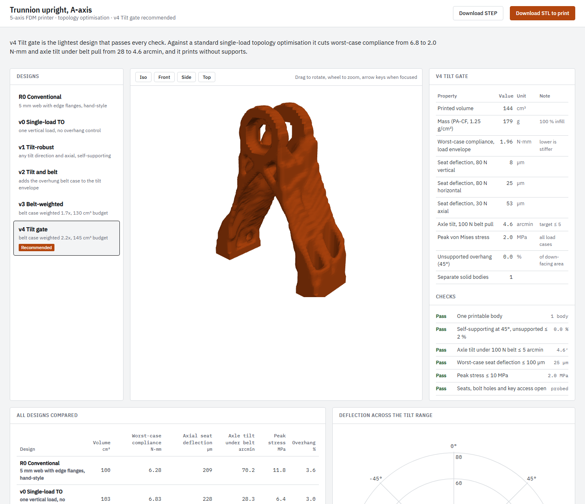

# trunnion-topopt

Topology-optimised A-axis trunnion upright for an AC-trunnion 5-axis FDM printer. The part is
optimised for the load direction turning with the tilt axis and for an overhung belt drive,
and it prints standing up with no supports.

**Results page:** https://juw12.github.io/trunnion-topopt/ (rotatable 3D view, every design compared,
pass/fail checks, files).

## Recommended part: v4

| | v0 single-load TO (baseline) | v2 tilt + belt | **v4 tilt gate** |
|---|---|---|---|
| Printed volume / mass (PA-CF, 1.25 g/cm³) | 103.5 cm³ / 129 g | 103.2 cm³ / 129 g | **143.5 cm³ / 179 g** |
| Worst-case compliance, 80 N any tilt + 30 N axial | 6.83 N·mm | 2.70 N·mm | **1.96 N·mm** |
| Axle tilt under 100 N belt pull (target ≤ 5′) | 28.3 arcmin | 8.9 arcmin | **4.6 arcmin** |
| Worst-case bearing-seat deflection | 228 µm | 34 µm | **25 µm** |
| Peak von Mises stress | 6.4 MPa | 3.3 MPa | **2.0 MPa** |
| Unsupported overhang at 45° | 3.0 % | 0.0 % | **0.0 %** |

All numbers come from linear FE on the exported geometry at 1.25 mm elements (about 1.16 M DOF),
not from the optimiser. Coarse (2.5 mm) and fine meshes agree within about 3 %.

- `models/trunnion_upright_v4_final.stl`: print file, watertight, one body.
- `models/trunnion_upright_v4_final_step.zip`: STEP, valid single solid, exact bearing seats,
  bore, M5 holes and hex-key access rebuilt in CadQuery (`src/trunnion_cad.py`).
- `models/trunnion_upright_v2_final.stl`: lighter option (meets 5′ if belt pull stays below 56 N).
- `models/trunnion_upright_v0_naive_baseline.stl`: single-load baseline for comparison.

## Method

- 3D SIMP on a 48 × 16 × 60 voxel grid (2.5 mm), geometric multigrid PCG solver.
- Worst-case objective: p-norm over the eigenvalues of the load-envelope compliance matrix, so the part
  is stiff for 80 N in *any* direction of the tilt plane plus 30 N axial, not one load case.
- Belt case: 100 N on a pulley 15 mm outboard of the outer bearing, in any tilt-plane direction.
- Langelaar AM filter for 45° self-supporting overhangs, build direction +Z.
- Keep-out and keep-in regions for the two 6001-2RS seats, 16 mm bore, bosses, M5 pads and key access.
- Post-processing: smooth signed-distance field, marching tetrahedra, interface probes,
  independent fine-mesh FE verification.

Design history, gates and the bugs found along the way: `results/refine_log.md`.

## Assumptions (not supplied, chosen and stated)

- Material PA-CF or PETG-CF treated as isotropic, E = 3.0 GPa, 100 % infill. Real prints are weaker
  between layers; peak stress is 2 MPa.
- Two 6001-2RS bearings (Ø28 seats, 8 mm deep), axle at 120 mm, base pads bolted with four M5.
- Axle-tilt limit 5 arcmin, half the 2-10 arcmin SKF lists for deep-groove ball bearings.

This is a checked computer model, not a tested part. Ream the seats to H7 for the press fit and confirm
stiffness with a test print.

## Running the code

Python 3.11+ with `numpy`, `scipy`; `cadquery` for the STEP rebuild. The scripts in `src/` expect to run
from a working folder containing `runs/` (density fields, see `results/designs/`) and write to `out/`.

## Licence

MIT
